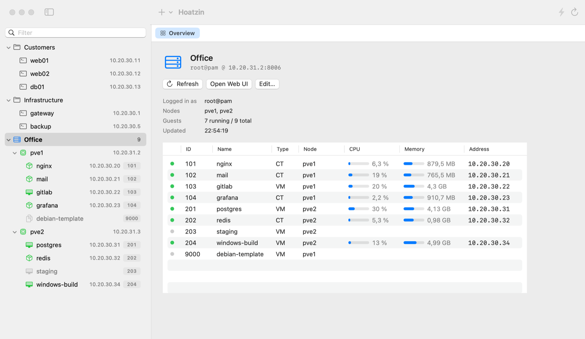
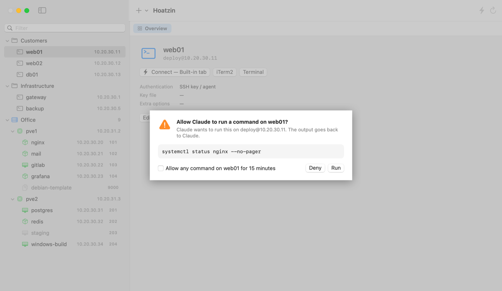
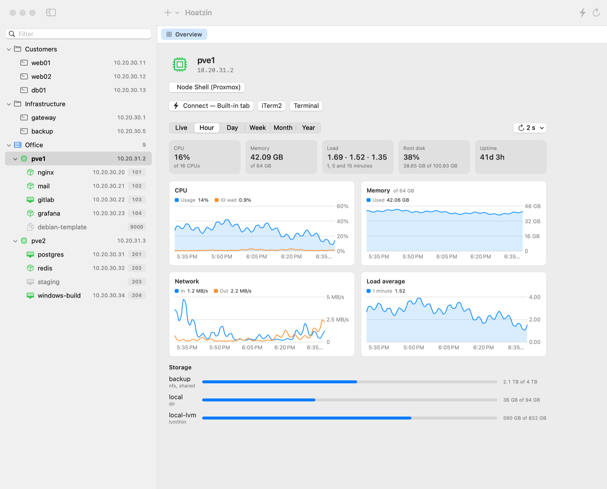

<p align="center"></p>

<h1 align="center">Hoatzin</h1>

The [hoatzin](https://en.wikipedia.org/wiki/Hoatzin) is a funny bird from the swamps of the Amazon:
a punk crest, a blue face and red eyes. Its chicks climb through branches with claws on their wings,
and it digests leaves in its crop much like a cow, which earned it the nickname "stinkbird". This
app shares its name, not its smell.

Hoatzin is a native macOS connection manager: a sidebar tree of folders and SSH connections, plus
Proxmox VE servers whose VMs and containers are listed live. Each connection opens via SSH, in
iTerm2, Terminal or a built-in terminal tab (based on
[SwiftTerm](https://github.com/migueldeicaza/SwiftTerm)), or through the Proxmox console
(xterm.js / noVNC).

**[Download the latest release](https://github.com/akitogo/hoatzin/releases/latest)**: a signed
app, notarized by Apple, for macOS 14 or later (see [Download](#download)).

<picture>
  <source media="(prefers-color-scheme: dark)" srcset="docs/screenshots/main-dark.png">
  
</picture>

## Why Hoatzin

* **Every credential stays in the macOS Keychain.** Hoatzin stores hosts, users and ports, never a
  password. Passwords come from your login keychain after Touch ID, or from the Passwords app via
  AutoFill. They reach ssh through a private socket, never through files, environment variables or
  command lines.
* **It works like a Mac app.** Native SwiftUI and AppKit instead of a web page in a window. Touch ID,
  the Keychain, Shortcuts, Siri and Spotlight are built in, the keyboard shortcuts are the familiar
  ones, and it speaks English and German.
* **AI apps can help with your servers, and you stay in charge.** Through its MCP server, Claude and
  other AI apps can find connections, read terminal tabs, open sessions and run commands. Hoatzin
  shows you every action before it happens, logs it, and never hands a password to the AI. AI
  access is off by default; you switch it on in *Settings → AI Access*.

<picture>
  <source media="(prefers-color-scheme: dark)" srcset="docs/screenshots/ai-dark.png">
  
</picture>

## What Hoatzin is not

Hoatzin is not a tool for managing Proxmox, and it doesn't replace the Proxmox web interface. It
doesn't create, start, stop, migrate or back up VMs and containers, and it doesn't change their
settings, storage or the cluster. For that, *Open Web UI* takes you to Proxmox in your browser.

It isn't a monitoring system either. The graphs give you a quick look at how a node or guest is
doing, but Hoatzin keeps no history of its own, sends no alerts, and only fetches values while a
page is open.

What Hoatzin is for is getting onto your machines quickly and working there comfortably:

* **Find it fast:** your SSH hosts and every VM and container of your Proxmox servers in one
  sidebar, with their addresses. Type a few letters in the filter, or ask Spotlight or Siri, and
  press Return to connect.
* **A real terminal:** SSH opens in iTerm2, Terminal or a built-in tab instead of a browser
  console. Copy and paste, scrollback, search, your fonts and your keyboard shortcuts work as
  usual, and several sessions sit side by side in tabs.
* **No typing passwords:** they come from the Keychain or the Passwords app, after Touch ID.
* **A way in when SSH can't help:** the Proxmox console of a VM or container is one click away,
  for example while it boots or when its network is down.

## Download

Download `Hoatzin-<version>.zip` from the
[latest release](https://github.com/akitogo/hoatzin/releases/latest), unzip it and move Hoatzin
to your Applications folder. It's signed with Akitogo's Developer ID and notarized by Apple, and
needs macOS 14 or later. Each release lists the zip's SHA-256.

## Credentials: what lives where

| Data | Stored in |
|---|---|
| Folders, names, hosts, ports, users, key-file paths, pinned Proxmox certificate fingerprint | `~/Library/Application Support/Hoatzin/library.json` |
| Passwords / key passphrases | macOS **login keychain** as internet-password items (server + account + protocol), visible in Keychain Access |
| Proxmox auth ticket | memory only |
| With iCloud sync on: a copy of `library.json` (never passwords) | your private iCloud database, end-to-end encrypted; the last synced state in `sync-state.json` next to the library |

**The Passwords app can't be read directly.** Its entries live in the iCloud/data-protection
keychain, which Apple restricts to Safari, the Passwords app and AutoFill. No third-party app can
query it, however it is signed. Hoatzin uses the supported path instead:

1. On connect, it looks for a Keychain item for `user @ host` (e.g. `root @ 10.20.30.192`, protocol ssh;
   Proxmox logins use protocol https).
2. If there is none, a sheet opens with AutoFill-enabled fields. Pick the entry from Passwords
   (key icon / Touch ID), or use *Copy host* + *Open Passwords* and paste.
3. With *Remember in the macOS Keychain* checked, the password is saved to the Keychain after ssh
   or Proxmox accepts it. Later connects need no prompt.

The *Keychain entry* field on a connection lets several connections share one stored password.

**Touch ID:** before Hoatzin uses a saved password it asks for Touch ID (or your Mac password),
then stays unlocked for a grace period (default 5 minutes; Settings → Passwords). It locks again
when the Mac sleeps or the screen locks, or via *Connection → Lock Saved Passwords* (⌥⌘L). This
check is enforced by the app. Keychain-enforced biometry would need an Apple-issued signing identity.

### How ssh gets the password

`ssh` runs with `SSH_ASKPASS=…/hoatzin-askpass` and `SSH_ASKPASS_REQUIRE=force`. The helper
forwards ssh's prompts (password, host-key confirmation, key passphrase, OTP) to the app over a
Unix socket in the per-user temp dir (mode 600). Passwords never appear in environment variables,
files or command lines, so this works the same in iTerm2 and Terminal.app.

Each session gets a random token, and the token is bound to one process. A built-in tab binds it
to the ssh it starts. The iTerm2 / Terminal launcher binds it to its own shell right before
`exec ssh`, which keeps the same process. The app only answers a request when:

* the caller runs as the same user;
* the caller is the bundled helper binary;
* the helper was started by `/usr/bin/ssh`;
* that ssh is the bound process or a child of it (ProxyJump);
* the token hasn't expired and its process is still running.

So another program that reads the token from ssh's environment can't use it, neither directly
nor by starting its own ssh. If something else binds a token first, the second bind revokes it
and the launch stops with a message in the terminal. Refusals are logged as
`Hoatzin: askpass request refused: …` (Console.app).

## Proxmox

* Add a server with host (port 8006), user and realm. The certificate is pinned on first use (TOFU)
  after you compare the SHA-256 fingerprint.
* Two-factor (TOTP) logins are supported (PVE 7+).
* Guest IPs come from the QEMU guest agent, LXC interfaces, or static `net*/ipconfig*` config.
  Override host, user or port per guest via *SSH Settings…*.
* The console is the Proxmox web console (xterm.js for containers and node shells, noVNC or serial
  for VMs) embedded in a tab, with the ticket held in a non-persistent web data store.
* Each guest shows its VMID as a grey pill at the right edge, with the IP to the left of it.
* **Usage:** the server's guest list shows each guest's CPU and memory use.
* **Graphs:** a node's page shows its CPU, memory, load, root disk and uptime, graphs of CPU
  (with IO wait), memory, network and load, and how full its storages are. A VM's or container's
  page shows the same figures and graphs of CPU, memory, network and disk IO. Pick *Live*,
  *Hour*, *Day*, *Week*, *Month* or *Year*; pointing at a graph shows the values of that moment
  in all of them.
* **Live values:** the graphs from *Hour* on come from Proxmox, which keeps at most one value per
  minute. *Live* is recorded by Hoatzin from the current values. How often they're fetched (every
  2 seconds to every minute, or only on request; 10 seconds by default) is set in the menu next to
  the periods or in *Settings → Proxmox*. The figures and the guest list's usage columns follow
  the same setting. Updates run only while the page is shown, and pause while Hoatzin's windows
  can't be seen. If values can't be updated, for example because the Proxmox login expired while
  the Mac slept, a note above them says why and since when they're old, with a button to log in
  again, and the old values are dimmed.
* **Nothing to install:** the data comes from Proxmox' own API with your Proxmox login. A login
  older than an hour is renewed in the background, so graphs left open don't ask for the
  password again.

<picture>
  <source media="(prefers-color-scheme: dark)" srcset="docs/screenshots/graphs-dark.png">
  
</picture>

## Tabs

* **⌘W** closes the selected tab. With no tab open it does nothing, because closing the main
  window quits Hoatzin.
* **⇧⌘W** closes the window on purpose.
* **Other windows:** in Settings and AI Activity, ⌘W closes that window.

## Favorites

Right-click an SSH connection, a Proxmox server, a node or a guest and choose *Add to Favorites*.
The sidebar then shows them in a group *Favorites* above the *Library*. Favorites are kept in the
library, so iCloud sync brings them to your other Macs and to Hoatzin on iPhone and iPad. A
favourite guest keeps its name while its server isn't loaded yet.

## Sidebar filter

The field above the sidebar (⌘F) narrows the tree in place:

* **What it matches:** names, VMIDs, IPs, hosts and SSH users, ignoring case and accents.
* **Several words:** every word has to match, either in an entry or in the folder or server it's
  in. So `office web` finds `web01` on the server Office.
* **Folders and servers:** a folder or server whose name matches keeps all its entries.
* **Keyboard:**
  * ↓ moves into the list.
  * Return connects to the selected match, or to the only match. With several matches it selects
    the first one.
  * Esc clears the filter. In the list, Esc also clears it and keeps the selection.
* **While filtering:** every branch is expanded, folders you collapsed stay collapsed afterwards,
  and drag & drop is off.

Long addresses in the sidebar are shortened at the start by default (…30.20), which keeps the part
that tells hosts apart. *Settings → Sidebar* switches to shortening at the end (10.20.3…).

## iCloud sync

*Settings → Library → Sync with iCloud* keeps folders, connections and Proxmox servers the same
on all your Macs signed in to the same iCloud account. Passwords are never part of it: they stay
in each Mac's Keychain.

* **Private and encrypted:** the library is one record in your private CloudKit database, stored
  in encrypted fields. Only your devices hold the keys; Apple and Akitogo can't read it.
* **When:** at launch, when Hoatzin becomes active, every 5 minutes and a few seconds after a
  change. When nothing changed, a sync only compares a change tag and downloads nothing.
* **Merging:** each Mac remembers the library as last synced. Changes made on two Macs in between
  are merged entry by entry: settings, folder and order separately. If both changed the same
  thing, the version that reached iCloud first wins. A deletion never beats an edit, and a
  deleted folder comes back if the other Mac put something new in it.
* **First sync on a Mac:** if both this Mac and iCloud have a different library, Hoatzin asks:
  merge both, use the iCloud library, or use this Mac's library. Before the first sync replaces
  anything, it keeps a copy as `library.before-icloud.json` next to the library.
* **Own builds:** a build from source needs an iCloud container and provisioning profile of its
  own (see [docs/development.md](docs/development.md)). Without one the switch is disabled.

## Languages

Hoatzin is in English and German and follows the Mac's language. The menus, windows, dialogs,
error messages and Shortcuts actions are translated, as are the Siri phrases and the AppleScript
permission text. To use another language for Hoatzin only, pick it in *System Settings →
General → Language & Region → Applications*.

* **Files:** the translations are in `Resources/de.lproj`:
  * `Localizable.strings`: the texts, keyed by the English text in the code.
  * `Localizable.stringsdict`: texts that depend on a count ("1 Eintrag", "3 Einträge"). English
    has one too.
  * `InfoPlist.strings`: the permission text from Info.plist.
  * `AppShortcuts.strings`: the Siri phrases.
* **Build check:** `scripts/build-app.sh` lets the compiler list every translatable text and runs
  `scripts/check-translations.swift`. The build fails if a text has no German translation or a
  translation lost a placeholder.
* **Stays English on purpose:** what AI apps receive (tool replies, MCP descriptions) and the
  entries in the AI activity log, which are stored data.

## AI access (MCP)

AI apps such as Claude can use Hoatzin through its MCP helper,
`Hoatzin.app/Contents/MacOS/hoatzin-mcp`.

**AI access is off by default.** Until you switch it on, every request from an AI app is refused.
To switch it on, choose a level in *Settings → AI Access*:

| Level | The AI may |
|---|---|
| Off (default) | nothing; every call is refused with a hint where to turn it on |
| Read only | list connections and open tabs, read built-in SSH tabs (if *Include terminal output* is on) |
| Read and open tabs | also open an entry as an SSH tab or Proxmox console, after you confirm in Hoatzin |
| Read, open tabs and run commands | also run a command over SSH and type into built-in SSH tabs, each after you confirm |

**Tools:**
* `list_connections(filter)`: same filter as the sidebar.
* `get_connection(id)`
* `list_sessions`
* `read_session(session_id, lines)`
* `open_session(id, method)`: `ssh` or `console`.
* `run_command(id, command, timeout_seconds)`: runs one command without a terminal and returns
  the exit code, stdout and stderr. Default timeout 60 s, at most 300 s. Output over 64 KB keeps
  its first 16 KB and last 48 KB.
* `send_input(session_id, text, key, wait_seconds)`: types into a built-in SSH tab, then presses
  `key` (Return by default; also Tab, Esc, Control-C/D/Z, arrows or none). It returns the tab's
  last lines once the output has been quiet for a moment.

**Setup:** *Settings → AI Access* copies the right command for Claude Code
(`claude mcp add --scope user hoatzin <path>`) or the `mcpServers` entry for Claude Desktop's
`claude_desktop_config.json`. Hoatzin has to be running; otherwise the tools say so.

**Safety:**
* **No passwords:** the AI never sees passwords. Tabs it opens and commands it runs get them from
  the Keychain via Touch ID, like anything else.
* **You confirm every action:** a sheet names the AI app, the host and the exact command or text.
  * Characters that are invisible or reorder text (e.g. U+202E) are shown as `<U+202E>`, and
    control characters as `^C`, `⎋`, `⇥`, so what you approve is what runs.
  * Return doesn't approve, and the approve button works only after a second: the sheet can
    appear while you're typing in another app. Esc denies.
  * *Allow … for 15 minutes* skips the question for that entry (opening, commands) or that tab
    (typing). Changing the access level forgets these.
  * A question nobody answers closes after 5 minutes and counts as denied.
* **Host keys:** commands from AI apps never accept a new or changed host key. Connect once
  yourself first. ssh runs with `StrictHostKeyChecking=yes`, and also without agent or X11
  forwarding, port forwards, `LocalCommand` or a background `ControlMaster`. These options come
  first on the command line, so neither `~/.ssh/config` nor an entry's extra arguments can undo
  them. Host-key questions from a ProxyJump hop are answered "no".
* **Who can connect:** the helper reaches the app over a socket in the per-user temp dir
  (mode 600). Only the bundled helper binary, running as you, may connect.
* **Output is marked untrusted:** the AI is told to treat it as data, since a remote host could
  print text meant to steer an AI.
* **Activity log:** *Window → AI Activity* (or *Settings → AI Access → Show AI Activity…*)
  lists every call: time, app, tool, target, result, and the command or typed text.
  * It's stored in `~/Library/Logs/Hoatzin/ai-activity.jsonl` (mode 600). At 2 MB the file
    moves to `ai-activity.1.jsonl`.
  * Terminal output and passwords are never written there.
  * Each call also goes to Console.app as `Hoatzin AI: <app> called <tool>`.

## Shortcuts, Siri & Spotlight

Hoatzin's actions are in the Shortcuts app (search for "Hoatzin"):

| Action | What it does |
|---|---|
| Open Connection | Opens a connection like a double-click in the sidebar, or explicitly via SSH or the Proxmox console |
| Find Connections | Returns connections matching words, like the sidebar filter |
| Run Command over SSH | Runs a command and returns its output |

* **Results:** each connection Find Connections returns has Name, Kind, Address, SSH Login, VMID,
  Status and Location. The output of Run Command can go into the next action.
* **Run Command errors:** a non-zero exit code is an error in Shortcuts, and the message includes
  stderr. Add `|| true` to a command when that's expected.
* **Siri and Spotlight:** they offer the actions without any setup, in English and German. For
  example "Open web01 in Hoatzin" / "Öffne web01 in Hoatzin", "Run a command on web01 with
  Hoatzin" / "Führe einen Befehl auf web01 mit Hoatzin aus", or "Find connections in
  Hoatzin" / "Suche Verbindungen in Hoatzin".
  * The phrases live in `Resources/<lang>.lproj/AppShortcuts.strings`, keyed by the English phrase
    in `Intents.swift`. A test checks that the files match the code and keep every placeholder.
  * Shortcuts shows the actions in German too (see *Languages*).
* **Spotlight results (macOS 15+):** connections are searchable by name, address, login and VMID,
  and picking one opens it. The index holds names, addresses and logins, never passwords. Turn it
  off in *Settings → Shortcuts, Siri & Spotlight*.
* **Proxmox data:** VMs and containers are loaded when an action needs them, which can ask for
  Touch ID.

**Run Command safety:**
* **Setting:** *Settings → Shortcuts, Siri & Spotlight → Run Command action* is *Off*, *Ask each
  time* (default) or *Run without asking*. Asking shows the host, the login and the exact
  command, with hidden characters made visible. Choose *Run without asking* only for shortcuts
  that must run unattended: any shortcut, Siri or Apple Intelligence can then run commands.
* **Same ssh rules as AI commands:** no new or changed host keys, no forwarding, and passwords
  from the Keychain via Touch ID.
* **Logging:** every run, including denied ones, goes to *Window → AI Activity* as
  "Shortcuts & Siri".

## Settings

*Hoatzin → Settings…* chooses where SSH sessions open (the built-in tab by default, iTerm2 or
Terminal). New iTerm2 sessions open as tabs in the front window via AppleScript (macOS asks
once for Automation permission); otherwise iTerm2 opens a new window. A built-in tab closes after a
clean logout (exit code 0) and, when the connection drops because the server restarts or the network
goes away, reconnects by itself for up to 5 minutes; both can be switched off. *Settings → Proxmox*
sets how often live values from Proxmox are updated.

## Building from source

```bash
scripts/build-app.sh             # → build/Hoatzin.app
scripts/build-app.sh --install   # also copies it to ~/Applications
```

Needs Xcode. Without a Developer ID certificate the app is signed ad hoc and runs on that Mac only;
without a provisioning profile of your own it has no iCloud sync. Signing, notarization, releases,
what the build script does and the switches for testing are in
[docs/development.md](docs/development.md).

## License

Copyright © 2026 Akitogo Internet and Media Applications GmbH.

Hoatzin is free software: you may use, change and pass it on, also commercially, under the terms
of the GNU General Public License, version 3 (see `LICENSE`). Whoever distributes a changed version
has to publish its source code under the same license. There is no warranty, to the extent
permitted by law.

### Additional terms

Section 7 of the GPL allows additional terms. These apply to all of Hoatzin:

1. **Attribution (section 7 b):** every copy and every changed version keeps the copyright notice
   above and the copyright and license notices in *About Hoatzin*.
2. **Origin (section 7 c):** a changed version is marked as changed. It must not be presented as
   the original Hoatzin, or as made or published by Akitogo Internet and Media Applications GmbH.
3. **Name and icon (section 7 e):** the name "Hoatzin" and the app icon
   (`Resources/AppIcon-source.png`, `Resources/AppIcon.icns`, `docs/icon.png`) are not covered by
   the GPL, and it grants no trademark rights to them. Forks need their own name and icon.

Bundled third-party code: [SwiftTerm](https://github.com/migueldeicaza/SwiftTerm) by Miguel
de Icaza (MIT License), the terminal in built-in tabs. Its license text is in *About Hoatzin*.
